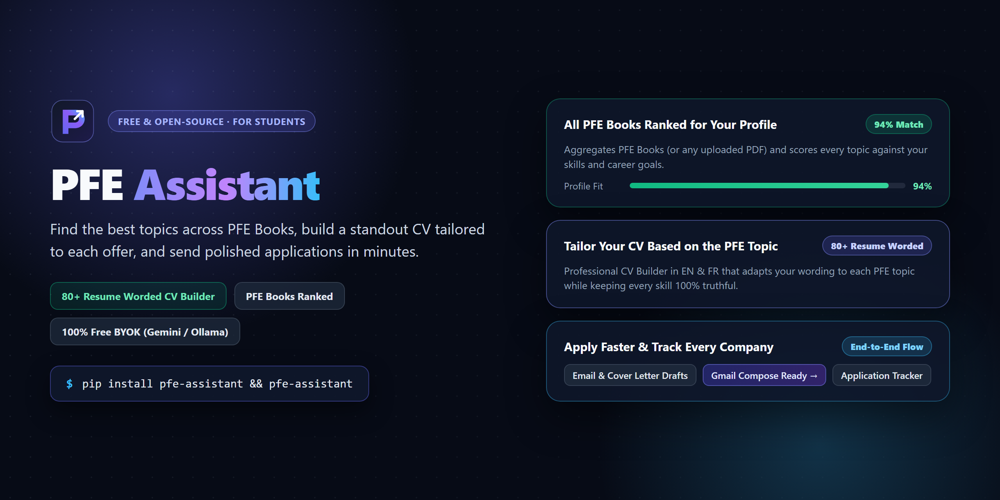

<p align="center">
  
</p>

# PFE Assistant

Local-first, **Bring-Your-Own-Key (BYOK)** web application that aggregates **PFE Books**, ranks topics against your profile, builds an **ATS-ready CV (80+ Resume Worded)** tailored to each PFE topic, drafts emails & cover letters, and tracks every application.

No servers, no subscriptions, and your CV & API keys never leave your computer.

---

## Key Features

- **Onboarding Wizard & Profile/CV Studio**: Import an existing CV PDF (AI-parsed) or build from scratch / load a sample CV, edit in English and/or French, and compile to an **exact 1-page PDF** via RenderCV + Typst (`pfeclassic` theme).
- **Multi-Profile Switcher**: Maintain isolated profiles (e.g., Data Science vs. Full-Stack, or separate users on one PC) with isolated match scores, application tracker, and uploaded documents.
- **Built-in `pfebooks.com` Sync + Custom PDF Upload**: Sync Tunisia 2026–2027 PFE Books automatically (or toggle `pfebooks.com` off in Settings and upload any company brochure PDF globally).
- **Dual Fit + Richness Scoring**: Scores every subject on **Profile Fit (0–100)** and **Topic Richness / Thesis Potential (0–100)** against your career goals and dealbreakers, plus head-to-head topic comparisons.
- **Truthful Staged CV Tailoring**: Proposes keyword & bullet edits per target topic, flags any token missing from your master CV as `unverified`, and enforces a **3-pass 1-page auto-fit** so your CV never spills onto page 2.
- **Grounded Drafting & Browser-Native Send Handoff**: Drafts concise plain-text emails + optional Typst cover letters, compiles your CV + cover letter + transcripts into a downloadable `.zip` or individual PDFs, and opens prefilled **Gmail Compose** (`authuser` aware) or your desktop mail app (`mailto:`).
- **BYOK Multi-Provider Support**: Works with **Google Gemini** (Recommended — free tier & native PDF reading), **OpenRouter**, **OpenAI**, **Groq**, **Ollama** (local/free), or any OpenAI-compatible endpoint.

---

## Quick Start

### Option 1: Install as a Python CLI (`pipx` / `pip`)

Requires **Python 3.11+** (no Node.js, no LaTeX, no Chrome required).

```bash
pip install pfe-assistant
pfe-assistant
```

Upgrade anytime with `pip install -U pfe-assistant` (your local profiles, SQLite database, and settings stay intact).

Or from a local clone with bundled frontend:

```bash
python scripts/build_package.py
pip install .
pfe-assistant
```

Your browser opens automatically on `http://127.0.0.1:8000`. User data is stored in `~/.pfe-assistant/` (override with `--data-dir` or `PFE_DATA_DIR`).

### Option 2: Run from Git Clone (`start.bat` / `start.sh`)

Requires **Python 3.11+** and **Node.js 20+** (only on first run to build the frontend bundle).

- **Windows**: Double-click `start.bat` (or run `.\start.bat` in PowerShell)
- **macOS / Linux**:
  ```bash
  chmod +x start.sh
  ./start.sh
  ```

---

## Getting a Free Google Gemini API Key (BYOK)

Google Gemini is recommended because it reads PDF brochures natively (including scanned PDFs) and offers a free tier with no credit card required:

1. Visit **[Google AI Studio — API Keys](https://aistudio.google.com/apikey)** and sign in with your Google account.
2. Click **Create API key** (create a new project if prompted).
3. Copy the key (`AIza...`) and paste it into the **Onboarding Wizard** or **Settings & API Key** page inside the app, then click **Test Connection**.

> Prefer local/offline or another provider? Select **Ollama**, **OpenRouter**, **OpenAI**, or **Groq** from the Provider Preset dropdown in Settings.

---

## Development Setup

Run backend and frontend with hot reload in two terminals:

```bash
# Terminal 1: Backend API
python -m venv .venv
# Windows: .venv\Scripts\activate  |  macOS/Linux: source .venv/bin/activate
pip install -r requirements.txt
uvicorn backend.app.main:app --reload --port 8000

# Terminal 2: Frontend Dev Server (proxies /api and /data to :8000)
cd frontend
npm install
npm run dev
```

Run tests (using an isolated temporary database):

```bash
python -m pytest backend/tests/ -v
```

---

## License

[MIT](LICENSE)
